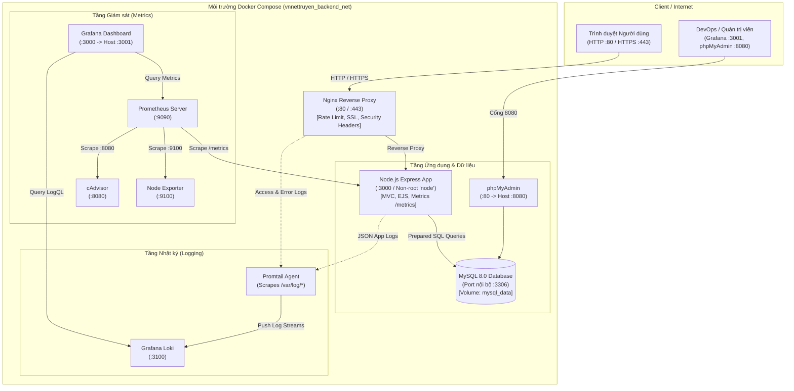

# VNnettruyen – Website Cộng Đồng Đọc và Sáng Tác Truyện Việt Nam

Dự án triển khai và quản trị hệ thống hoàn chỉnh theo **Đề 15: Diễn đàn/Cộng đồng (Forum)** môn **Triển khai và Quản trị Hệ thống Phần mềm**.

---

## 1. Tổng quan dự án

**VNnettruyen** là nền tảng website cộng đồng dành cho độc giả và tác giả Việt Nam, hỗ trợ đọc tiểu thuyết mạng, sáng tác truyện, quản lý chương truyện, bình luận trao đổi và quản trị nội dung.

### Công nghệ sử dụng:
- **Backend:** Node.js (v20) + Express.js, MVC Pattern, Prepared Statements chống SQLi.
- **Frontend:** Vanilla HTML5, CSS3 hiện đại (Dark Slate & Cyberpunk theme, Responsive Mobile/Desktop), JavaScript, EJS Template Engine.
- **Cơ sở dữ liệu:** MySQL 8.0, phân quyền người dùng (Reader, Author, Admin), lưu trữ session bền vững trong MySQL (`sessions` table).
- **Quản trị CSDL:** phpMyAdmin 5.2.
- **Reverse Proxy & Web Server:** Nginx 1.25 Alpine (Reverse proxy port 80 & 443 SSL, Rate limiting, Security headers).
- **Container hóa:** Docker & Docker Compose v5.5.
- **Hệ thống Giám sát (Monitoring):** Prometheus v2.51 + Grafana 10.4 + cAdvisor + Node Exporter.
- **Hệ thống Nhật ký (Logging):** Loki v3.0 + Promtail v3.0, truy vấn LogQL tập trung.
- **Bảo mật & Gia cố (Hardening):** Non-root user, tách mạng nội bộ, CSP, Rate limit chống brute-force, bảo vệ mật khẩu bằng bcrypt.

---

## 2. Sơ đồ kiến trúc hệ thống



---

## 3. Cấu trúc thư mục dự án

```text
VNnettruyen/
├── app/                              # Mã nguồn Node.js Express Webapp
│   ├── src/
│   │   ├── config/                   # db.js, logger.js, metrics.js
│   │   ├── controllers/              # authController, storyController, authorController, adminController
│   │   ├── middleware/               # auth.js, rateLimiter.js
│   │   ├── routes/                   # index.js, auth.js, author.js, admin.js
│   │   └── app.js                    # Entrypoint chính của ứng dụng
│   ├── views/                        # EJS Templates
│   │   ├── partials/                 # header.ejs, footer.ejs
│   │   └── pages/                    # index, stories, story-detail, chapter-reader, login, register, profile
│   │       ├── author/               # dashboard, create/edit story, chapters, create/edit chapter
│   │       └── admin/                # dashboard, users, stories, genres, comments
│   ├── public/                       # CSS, JS, hình ảnh tĩnh
│   │   ├── css/style.css
│   │   ├── js/main.js
│   │   └── images/
│   ├── Dockerfile                    # Containerfile chạy bằng user non-root
│   └── package.json
├── database/
│   └── init.sql                      # Schema khởi tạo bảng, khóa ngoại, chỉ mục & seed data
├── nginx/
│   ├── nginx.conf                    # Cấu hình Reverse proxy, SSL, Security headers & JSON log
│   └── ssl/                          # Chứng chỉ SSL server.crt và server.key
├── prometheus/
│   └── prometheus.yml                # Cấu hình targets scrape metrics
├── grafana/
│   └── provisioning/
│       ├── datasources/              # Tự động nạp Prometheus & Loki datasource
│       └── dashboards/               # Tự động nạp dashboard JSON hệ thống
├── loki/
│   └── loki-config.yaml              # Cấu hình lưu trữ và ingest log của Loki 3.0
├── promtail/
│   └── promtail-config.yaml          # Thu thập log Nginx và Webapp gửi tới Loki
├── docker-compose.yml                # Khởi tạo và quản lý toàn bộ 10 container
├── .env                              # Biến môi trường thực tế (Đã cấu hình sẵn cho Lab)
├── .env.example                      # Biến môi trường mẫu
├── .gitignore                        # Chặn commit thông tin nhạy cảm, log, node_modules
└── README.md                         # Hướng dẫn chi tiết dự án
```

---

## 4. Tài khoản kiểm thử có sẵn

Hệ thống đã nạp sẵn dữ liệu kiểm thử trong `database/init.sql`:

| Vai trò | Tên đăng nhập | Email | Mật khẩu | Quyền hạn |
| :--- | :--- | :--- | :--- | :--- |
| **Quản trị viên (Admin)** | `admin` | `admin@vnnettruyen.vn` | `Admin@123456` | Toàn quyền quản trị hệ thống, người dùng, truyện, thể loại, bình luận |
| **Tác giả (Author)** | `tacgia_viet` | `author@vnnettruyen.vn` | `Author@123456` | Đăng tác phẩm mới, sửa/xóa truyện & chương của mình, studio sáng tác |
| **Độc giả (Reader)** | `docgia_vn` | `reader@vnnettruyen.vn` | `Reader@123456` | Đọc truyện, tùy chỉnh cỡ chữ, lưu tủ sách yêu thích, bình luận truyện |

---

## 5. Hướng dẫn khởi chạy hệ thống

### Bước 1: Chuẩn bị môi trường
Đảm bảo máy đã cài đặt Docker và Docker Compose. Kiểm tra bằng lệnh:
```bash
docker --version
docker compose version
```

### Bước 2: Tạo file cấu hình môi trường `.env`
Sao chép từ file mẫu:
```bash
cp .env.example .env
```
*(File `.env` mặc định đã được tạo sẵn trong thư mục cho môi trường Lab).*

### Bước 3: Khởi động toàn bộ hệ thống bằng Docker Compose
```bash
docker compose up -d --build
```

### Bước 4: Kiểm tra trạng thái các container
```bash
docker compose ps
```
Tất cả các dịch vụ phải ở trạng thái `Up` hoặc `Up (healthy)`.

---

## 6. Danh sách cổng và đường dẫn truy cập

| Dịch vụ | Cổng truy cập | URL | Chức năng |
| :--- | :--- | :--- | :--- |
| **VNnettruyen Webapp** | 80 & 443 | `http://localhost` hoặc `https://localhost` | Giao diện đọc và sáng tác truyện |
| **phpMyAdmin** | 8080 | `http://localhost:8080` | Quản trị CSDL (User: `vnnettruyen_user` hoặc `root`) |
| **Grafana Dashboard** | 3001 | `http://localhost:3001` | Dashboard giám sát (User: `admin` / Pass: `VNnet_GrafanaPass_2026!`) |
| **Prometheus Web UI** | 9090 | `http://localhost:9090/targets` | Kiểm tra trạng thái scrape targets |
| **Node.js Healthcheck** | 3000 (Internal) | `http://localhost/health` | Kiểm tra tình trạng kết nối DB & uptime |
| **Prometheus Metrics** | 3000 (Internal) | `http://localhost/metrics` | Dữ liệu thô Prometheus metrics |
| **Loki API** | 3100 | `http://localhost:3100/ready` | Kiểm tra dịch vụ Loki sẵn sàng |

---

## 7. Giám sát hệ thống với Prometheus & Grafana

### Các chỉ số Metrics chính:
- **Ứng dụng cung cấp (Application Metrics):**
  - `vnnettruyen_http_requests_total`: Tổng số lượt request phân loại theo method, route, HTTP status code.
  - `vnnettruyen_http_request_duration_seconds`: Histogram đo thời gian phản hồi (latency) của từng API.
  - `process_resident_memory_bytes`: Dung lượng bộ nhớ RAM Node.js đang sử dụng.
  - `nodejs_heap_size_used_bytes`: Kích thước heap memory V8 engine đang chiếm dụng.
  - `process_cpu_seconds_total`: Tần suất CPU của ứng dụng.
- **Exporter cung cấp (Infrastructure Metrics):**
  - `node_cpu_seconds_total`: Sử dụng CPU toàn máy chủ (Node Exporter).
  - `container_cpu_usage_seconds_total`: Sử dụng CPU của từng container (cAdvisor).
  - `container_memory_usage_bytes`: RAM của từng container (cAdvisor).

---

## 8. Truy vấn Nhật ký Log với Loki, Promtail & LogQL

Để truy vấn log:
1. Mở Grafana tại `http://localhost:3001`.
2. Vào menu **Explore** (biểu tượng la bàn) ở thanh điều hướng bên trái.
3. Chọn Data source: **Loki**.
4. Sử dụng các câu truy vấn **LogQL** thực tế dưới đây:

### Các câu truy vấn LogQL mẫu:
- **Xem toàn bộ log của Nginx Reverse Proxy:**
  ```logql
  {job="nginx"}
  ```
- **Lọc các request Nginx gặp lỗi máy chủ HTTP 5xx:**
  ```logql
  {job="nginx"} |~ "\"status\": \"5[0-9]{2}\""
  ```
- **Xem toàn bộ log của ứng dụng Webapp:**
  ```logql
  {job="webapp"}
  ```
- **Tìm kiếm các lỗi Exception, Error hoặc Failed trong ứng dụng:**
  ```logql
  {job="webapp"} |~ "(?i)(error|exception|failed)"
  ```
- **Xem lịch sử đăng nhập:**
  ```logql
  {job="webapp"} |= "Người dùng đăng nhập thành công"
  ```

---

## 9. Các biện pháp Gia cố Bảo mật (Hardening Checklist)

1. **Chạy dưới quyền người dùng không đặc quyền (Non-root user):**
   - Ứng dụng Node.js trong Dockerfile chuyển sang `USER node` ngay sau khi cài đặt gói, giảm thiểu nguy cơ leo thang đặc quyền.
2. **Cô lập cơ sở dữ liệu MySQL:**
   - Cổng `3306` của MySQL **không hề được mở ra máy host** trong `docker-compose.yml`. Chỉ các container trong mạng nội bộ `backend_net` mới kết nối được.
3. **Phân tách mạng Docker Networks:**
   - Dùng mạng bridge riêng `vnnettruyen_backend_net` để cô lập các dịch vụ.
4. **Bảo vệ mật khẩu:**
   - Mã hóa 100% mật khẩu người dùng bằng giải thuật băm một chiều `bcryptjs` với salt rounds = 10. Không bao giờ lưu văn bản thuần (plaintext).
5. **Bảo mật phiên đăng nhập (Session Hardening):**
   - Lưu session trong bảng `sessions` của MySQL, bật cờ `httpOnly: true`, `sameSite: 'lax'`.
6. **Chống tấn công Brute-force & DoS:**
   - Cấu hình Nginx `limit_req_zone` (tối đa 20 request/giây, burst 40).
   - Tích hợp `express-rate-limit` giới hạn tối đa 30 lần thử đăng nhập/đăng ký trong 15 phút.
7. **Phòng chống XSS & SQL Injection:**
   - Áp dụng `mysql2/promise` prepared statements chống triệt để SQL Injection.
   - Dùng `sanitize-html` để khử trùng nội dung bình luận và dữ liệu đầu vào.
8. **HTTP Security Headers:**
   - Cấu hình qua cả thư viện `helmet` và Nginx: `X-Frame-Options: SAMEORIGIN`, `X-Content-Type-Options: nosniff`, `Referrer-Policy: strict-origin-when-cross-origin`.
9. **Ẩn thông tin phiên bản máy chủ:**
   - Nginx thiết lập `server_tokens off;` để che giấu version.

---

## 10. Hướng dẫn Quản lý Mã nguồn Git & GitHub

Khởi tạo và đẩy mã nguồn lên GitHub:
```bash
# 1. Kiểm tra trạng thái Git
git status

# 2. Thêm toàn bộ các file dự án
git add .

# 3. Thực hiện commit phiên bản hoàn chỉnh
git commit -m "feat: deploy complete VNnettruyen system with full observability and hardening"

# 4. Đổi tên nhánh chính thành main
git branch -M main

# 5. Thêm remote repository GitHub của bạn (thay username/repo)
# git remote add origin https://github.com/<YOUR_USERNAME>/VNnettruyen.git

# 6. Đẩy mã nguồn lên GitHub
# git push -u origin main
```

---

## 11. Dừng và dọn dẹp hệ thống

Để dừng toàn bộ dịch vụ:
```bash
docker compose down
```

Nếu muốn xóa sạch toàn bộ volume dữ liệu để khởi động lại từ đầu:
```bash
docker compose down -v
```
